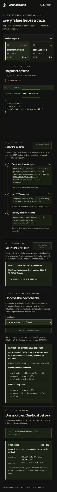

# Webhook Clinic

A local inspection desk for failed webhook deliveries.

## Problem and user

When a webhook delivery fails, a backend developer has to work out why (bad signature, receiver error or timeout) and then decide whether it is safe to send it again. Logs rarely keep the exact evidence, and a careless replay can deliver the same event twice or to the wrong place. Webhook Clinic shows that workflow end to end on three synthetic failures: inspect the evidence, run deterministic diagnostics, review the cited evidence, and replay once, with explicit approval, to a fixed local receiver. Every step leaves an audit record.

## Features

- Three seeded synthetic failures, actually reproduced against a bundled receiver: invalid HMAC (401), receiver unavailable (503) and a missed 150 ms deadline.
- Immutable, redacted request/response snapshots. The HMAC is verified over the private exact bytes before redaction.
- Three deterministic diagnostics (signature, HTTP status, deadline), each citing its source evidence.
- Optional evidence investigation: a no-key fixture selector, or Gemini (`gemini-3.5-flash-lite`) with your own key. The model can only pick allowlisted checks and quote existing evidence; it cannot replay or choose a destination.
- Approved replay: a newly signed payload goes only to `127.0.0.1:<receiver port>/receive`. Redirects and automatic retries are disabled. Redis coordinates and MongoDB unique indexes ensure one retained audit per fixture.
- Keyboard-accessible, responsive UI with a clear fixture-mode label.

## Screenshots

| Desktop | Mobile |
|---|---|
|  |  |

These screenshots come from a fresh clone that ran with port overrides, so the receiver is shown on port 9111.

## Quick start (fixture mode, no key)

Requires Node 22+ and Docker with Compose. Everything binds to `127.0.0.1`. Default ports: UI **5174**, API **8011**, receiver **9011**, MongoDB **27018**, Redis **6381**.

```sh
git clone https://github.com/abdulrehmanawan99/webhook-clinic.git
cd webhook-clinic
npm ci
docker compose up -d --wait
npm run dev
```

Open **http://127.0.0.1:5174**. Use exactly this address: the API rejects changes from any other origin.

1. Select a delivery in the queue (for example, `shipment.created`).
2. Run diagnostics, then read the evidence cited for each check. You can also reproduce the failure locally.
3. Optionally, run the fixture investigation (no inference).
4. Tick the approval box and click **Approve & replay locally**.
5. The retained audit (status, correlation ID, approval time) replaces the approval control and persists after a reload.

Each fixture allows exactly one replay attempt, by design. Stop with Ctrl-C. `docker compose stop` keeps the data.

### Ports already in use?

Copy `.env.example` to `.env` and uncomment the port variables. The server, Vite and Docker Compose all read `.env`. The allowed UI origin follows `CLINIC_UI_PORT`. To run a second copy next to an existing one, also set a separate Compose project:

```sh
COMPOSE_PROJECT_NAME=webhook-clinic-2
CLINIC_UI_PORT=5274
CLINIC_API_PORT=8111
CLINIC_RECEIVER_PORT=9111
CLINIC_MONGO_PORT=27118
CLINIC_REDIS_PORT=6481
```

Then open `http://127.0.0.1:5274`. Variables exported in your shell take precedence over `.env`.

## Use your own Gemini key

1. Create an API key in [Google AI Studio](https://aistudio.google.com/apikey).
2. Run `cp .env.example .env` and set `GEMINI_API_KEY=<your key>` in `.env`. Exporting `GEMINI_API_KEY` in your shell also works.
3. Restart `npm run dev`. `GET http://127.0.0.1:8011/api/config` should report `"geminiAvailable": true`.
4. In the UI, run diagnostics, choose **Gemini** under *Investigator* and request the investigation.

The model is fixed to `gemini-3.5-flash-lite`. The key stays on the server and is never sent to the browser, stored or logged. Only the three synthetic diagnostic findings are sent to Google's API. Each delivery gets one Gemini attempt; a failed attempt stays visible and is not retried. **Billing, quota and data-use terms are governed by your own Google project.** The app does not check them, so review your plan before you enable the key.

## Tests

```sh
npm test                  # offline unit/domain/provider-contract tests; no network calls
npm run build             # strict type check and production UI bundle
npm run evaluate          # rescore the recorded Gemini baseline offline; no inference
npm run check:secrets     # pattern scan of tracked text and the frontend bundle
npm run test:integration  # needs the app and databases running; writes an audit
npm run test:browser      # Playwright end-to-end workflow and axe scan (npx playwright install chromium)
npm run test:scenarios    # app stopped first; briefly stops this project's MongoDB/Redis
npm run licenses          # offline dependency license inventory
```

CI runs all of these except `licenses` on every pull request, with Gemini disabled.

## Limitations

- Portfolio demo for a trusted local machine. There are no accounts, no arbitrary webhook ingestion, no production destinations and no cloud deployment.
- Diagnostics cover three known synthetic failure types; the redactor is built for these fixtures, not for arbitrary data.
- Gemini was live-tested on 3 synthetic cases only, with `gemini-3.5-flash-lite` only ([record](docs/live-validation.md)). Broader model quality is unverified, and no other provider is supported.
- No distributed exactly-once guarantee. A crash or timeout leaves a pending or uncertain audit, which the app shows rather than retrying.

## Troubleshooting

- **"Mutations require the local Clinic UI origin."**: open `http://127.0.0.1:<CLINIC_UI_PORT>` exactly (not `localhost` and not another port).
- **Port already in use / `strictPort` error**: set the `CLINIC_*_PORT` overrides shown above. Do not stop other applications.
- **API exits with a MongoDB or Redis connection error**: run `docker compose ps`, and if needed `docker compose up -d --wait`. Check that `CLINIC_MONGO_PORT`/`CLINIC_REDIS_PORT` match in `.env`.
- **Gemini option disabled**: `GEMINI_API_KEY` is empty or not visible to the server. Restart after editing `.env`.
- **Replay button gone / nothing happens on a second replay**: by design, one attempt per fixture. The audit is shown instead.
- **Start over**: `docker compose down -v` deletes this project's database volume. The fixtures are re-seeded on the next start.

## Docs

- [Architecture](docs/architecture.md)
- [Threat model](docs/threat-model.md)
- [Provider and evaluation boundaries](docs/provider-evaluation.md)
- [Evaluation gates](docs/evaluation.md)
- [Live validation record](docs/live-validation.md)
- [Verification record](docs/verification.md)
- [Release review](docs/release-review.md)
- [Third-party attribution](docs/third-party.md)
