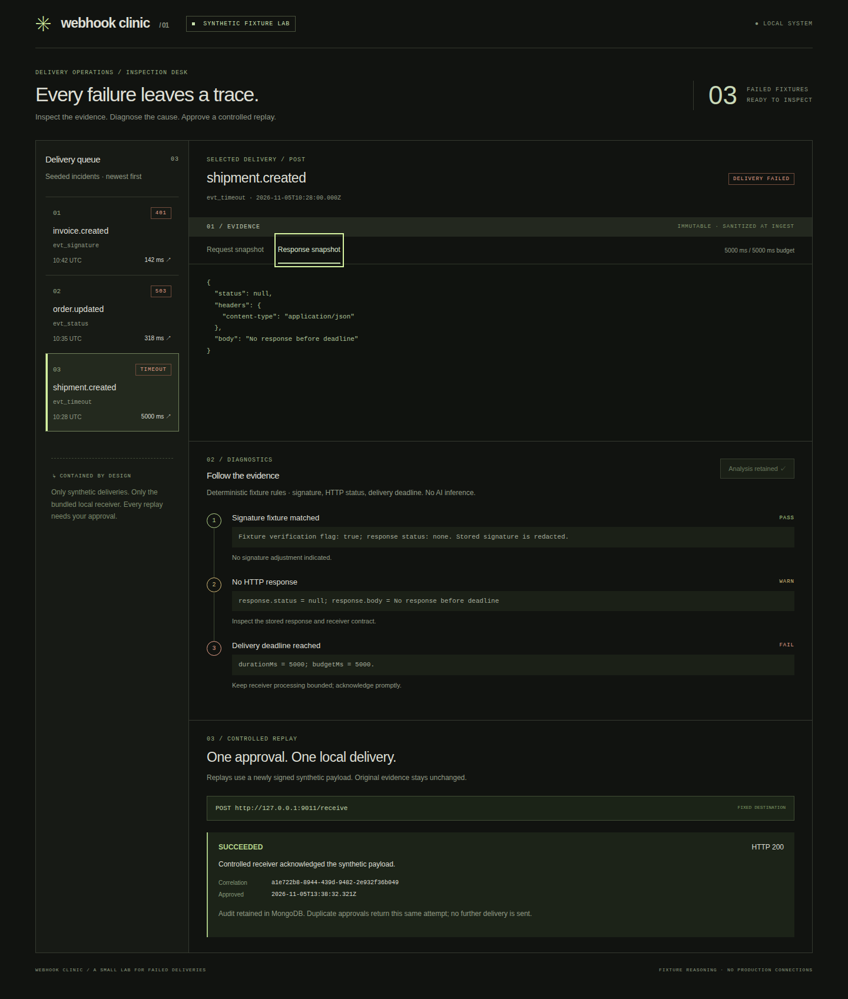

# Webhook Clinic

A local inspection desk for failed webhook deliveries. React + Vite/TypeScript, Express/TypeScript, MongoDB and Redis. Three synthetic failures cover an invalid signature, HTTP 503 and a delivery timeout. The no-key workflow uses **deterministic fixture reasoning**. An optional server-only Gemini evidence selector passed a [three-case synthetic live compatibility check](docs/live-validation.md); broader model quality remains unverified.

The original v1 local workflow includes real failure reproduction, exact-byte HMAC verification, evidence investigation and an explicitly approved replay. Full PRD AI acceptance remains open for broader quality evaluation and a second supported provider configuration; only the exact Gemini model used in the recorded baseline is currently authorized.



## Run locally

Requires Node 22+ and Docker Compose. Use these dedicated loopback ports: UI **5174**, API **8011**, controlled receiver **9011**, MongoDB **27018**, Redis **6381**. Check that they are free first; do not stop unrelated applications.

```sh
npm ci
docker compose up -d --wait
npm run dev
```

Open **http://127.0.0.1:5174** (use this exact host; mutation origin checks intentionally reject other origins). Select a fixture, inspect request/response snapshots, run diagnostics, review their source evidence, check the explicit approval box, then replay. A retained audit replaces the approval control. Other fixtures remain available to exercise the flow.

Defaults work without an env file. `.env.example` documents optional overrides. To use one, copy it to `.env` and export its variables in your shell before starting; the app does not automatically load it. Only synthetic signing material belongs here.

```sh
npm run build             # strict type check + UI bundle
npm test                  # domain, provider/scoring regressions; offline
npm run evaluate          # rescore persisted live baseline; no inference
npm run check:secrets     # bounded tracked-text + frontend-bundle pattern check
npm run licenses          # offline locked/installed dependency inventory
npm run test:integration  # running app + local MongoDB required; retains audit
npm run test:scenarios    # app ports FREE; starts isolated app; briefly stops project DB/cache
npm audit
```

`npm start` runs the API and bundled receiver only. `npm run dev` also runs Vite. Ctrl-C stops the application. `docker compose stop` preserves MongoDB data. No reset or deletion is needed; seed insertion uses `$setOnInsert` and repeated approvals return the existing audit.

## Workflow and boundaries

- Sanitized fixtures are inserted once and served as immutable request/response evidence. There is no ingestion or edit endpoint.
- Seed creation actually sends private synthetic bytes to the bundled receiver: invalid HMAC returns 401, controlled unavailability returns 503, and a delayed response exceeds a 150 ms deadline. The separate reproduce action retains a new observation without replacing original evidence.
- Three fixed diagnostics retain source fields. HMAC is verified over private exact bytes before redaction; only its result, byte count and body hash are persisted. The sanitized inspector body must not be used to verify the original signature.
- Optional investigation selects up to three allowlisted evidence checks with exact validated citations. Fixture mode performs no inference. Gemini mode requires an explicit UI request and server-side configuration; it cannot replay or choose a destination. See [provider and evaluation boundaries](docs/provider-evaluation.md).
- Replay requires a retained diagnosis plus explicit approval. The server signs a new synthetic payload and sends it only to the compiled-in `127.0.0.1:9011/receive` destination. Client-supplied destinations are rejected. Redirects and automatic retries are disabled.
- Redis holds a short replay coordination lock. MongoDB unique indexes enforce one audit per delivery and one receiver receipt per correlation ID. Redis is coordination, never the durable source of truth.
- Each fixture allows one retained attempt, including failure or uncertain acknowledgement. This deliberate limit avoids accidental duplicate delivery. A process crash after approval can leave a pending audit; inspect it rather than replaying automatically.

See [frozen evaluation gates](docs/evaluation.md), [release review](docs/release-review.md), [third-party attribution](docs/third-party.md), [architecture and threat boundaries](docs/architecture.md) and [actual verification](docs/verification.md). This is a trusted-machine portfolio demo with no accounts, production credentials, arbitrary destinations or background workers. The optional live investigator sends only retained synthetic diagnostic findings to the fixed Gemini API endpoint.

Storage namespace `webhook_clinic_v2` identifies the revised capture schema, not a product release. Earlier `webhook_clinic` deliveries and audits are preserved untouched. No migration silently rewrites immutable evidence.
