# Architecture and threat boundaries

One Express process owns the Clinic API and a second, bundled receiver listener. Vite serves React and proxies `/api` locally. MongoDB persists sanitized deliveries, retained diagnoses, approval/replay audits, and receiver receipts. Redis supplies a 10-second, owner-checked replay lock. A small optional Gemini adapter selects evidence through the same validated domain result as fixture mode; no queue or provider SDK is needed.

## Data flow

1. Known synthetic failures are captured from the bundled local receiver, with HMAC verified over private exact bytes; snapshots are recursively redacted before insert. Authorization, cookies, signatures, token/secret/password/email keys are replaced; raw synthetic secret values are not persisted. This redactor is tailored to these known fixtures and is not a safe arbitrary-data ingestion pipeline.
2. Delivery snapshots have no update API. Diagnostics run exactly three rules, retain evidence and are uniquely keyed by delivery ID. A separate reproduce action retains another observation. Optional investigation selects allowlisted check IDs and exact evidence quotes; prose comes only from retained rules. Results record provider/model, source version, timestamps and token usage when supplied. No live AI result is claimed without an actual provider run.
3. A POST with the exact approval literal creates a durable audit before network work. MongoDB uniqueness fences races even after Redis expiry/restart. The audit correlation UUID accompanies the new signed request.
4. Receiver validates HMAC over exact bytes, fixture ID and pre-existing approval audit; its unique correlation receipt prevents duplicate processing. It does not store incoming payload or headers. The sender records status and bounded generic result, not arbitrary response bodies.

```mermaid
flowchart LR
  Receiver[Bundled synthetic receiver] --> Capture[Exact-byte verification and redacted capture]
  Capture --> Delivery[(Immutable Mongo delivery)]
  Delivery --> Rules[Three deterministic diagnostics]
  Rules --> Selection[Fixture or bounded Gemini evidence selection]
  Selection --> Review[Human evidence review and explicit approval]
  Review --> Fence[Redis coordination and unique Mongo audit]
  Fence --> Local[Fixed local replay receiver]
  Local --> Receipt[(Unique receipt and retained audit)]
```

## Controls and limits

- API/UI/database/cache listeners use loopback. API mutation requires the exact UI Origin and API Host is checked. No CORS enablement. This is not authentication; trusted local processes and people with database access remain privileged.
- API request bodies and receiver payloads are capped at 16 KiB. Fixed fixture IDs and strict approval/pagination schemas reject extra fields; list limits are 1–20 and pages 1–100. HTTP server header/request bounds are 5 seconds. Replay network deadline is 1.5 seconds; redirect following is forbidden.
- Replay destination is a code constant, not request input or an environment setting. No user-provided URLs, headers, secrets, or production data are accepted. The demo HMAC key is intentionally synthetic and not a production credential.
- Redis callers have a one-second deadline with cleared application timers, a 128-command queue cap and offline queueing disabled. Driver abort signals are avoided because Redis 4 retains their listeners after completion. A timed-out lock cannot authorize audit creation or sending; a late lock expires after ten seconds.
- If Redis fails, a new replay fails closed. MongoDB unique indexes preserve deduplication. After uncertain delivery or a crash, pending/uncertain audit is retained with no automatic retry. The system does not promise distributed exactly-once delivery.
- Redaction, constraints and immutable snapshots protect this small fixed fixture workflow. This does not provide tamper-evident auditing against a database administrator or secure untrusted deployment.

Gemini is gated by a nonempty server-only key and explicit free-tier confirmation. Its fixed endpoint receives only synthetic diagnostic findings. Each delivery/mode permits one durable attempt, including failed/pending outcomes; there are no automatic retries or fallback calls. A 10-second deadline, 1,800 output-token limit, 32 KiB response cap and strict schema/citation checks bound execution. The model has no network or replay tools. See the provider/evaluation notes and live baseline for actual compatibility coverage and remaining quality limits.

No arbitrary ingestion, auth, cloud, production replay or manual retry/reset UI is included. Bindings remain local. The revised capture schema uses a separate `webhook_clinic_v2` database, preserving earlier immutable evidence and audits.
